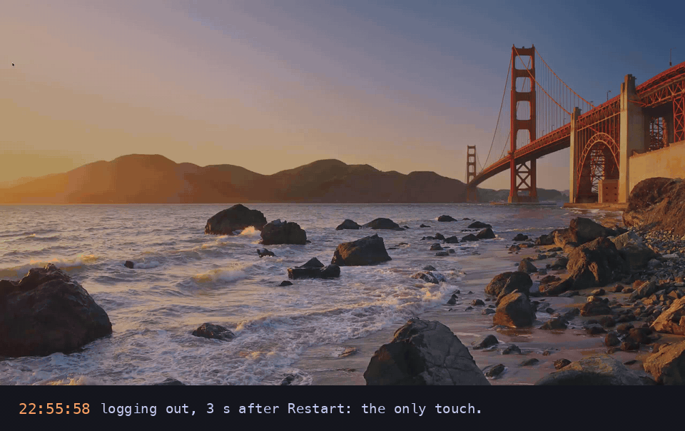

<!-- ourostack:brand:start -->
<p align="center">
  <a href="https://github.com/ourostack"></a>
</p>
<!-- ourostack:brand:end -->

# housesitter

**A $100 KVM beside your agents' Mac. When the Mac restarts, it unlocks FileVault. When it can't, it tells you.**

[Quickstart](#three-cables-two-commands) · [Why I built it](#why-i-built-it) · [housesitter doctor](#housesitter-doctor) · [The password rules](#the-password-rules) · [What's verified](#whats-verified) · [More from Ouro](https://github.com/ourostack)

```sh
npx github:ourostack/housesitter demo     # the day it was built for, replayed from real frames; no hardware
```

<p align="center"></p>

*Recorded by our KVM on 8 November 2026, from the Mac's own HDMI port. We restarted our Mac mini and walked away. FileVault came up at 18:31:55, the KVM typed the password once at 18:32:37, at the field it could see, and the desktop was back 19 seconds later; everything on the mini came back by itself. Only the boot and FileVault frames are shown: the desktop is ours. What typed here is our private watchdog, the code housesitter was generalised from, with the same rules; housesitter's own sitter hasn't typed on real hardware yet ([what's verified](#whats-verified)).*

## Why I built it

On Sunday morning one of our agents changed a display setting on the KVM beside our Mac mini. Ten seconds later macOS's login window and its sign-in services crashed, and every agent on the mini went down with them. We typed the right password through the KVM three times. None of it reached a password field: the first key, Escape, had switched the login window to its list of users, and the display the KVM was watching didn't show the field at all. The mini sat locked from 10:11 until I logged in by hand at 17:54.

So housesitter types only where it can see the password field. That morning it would have refused and sent me one message. That evening we taught it our lock screen, restarted the mini and left it alone. It was back at its desktop in 1 minute 44 seconds.

## housesitter doctor

<p align="center"></p>

*A real `housesitter doctor` run against our mini and its GL.iNet Comet at 18:33, a minute after that restart, with `--private` so the picture of my desktop stays out of the screenshot. This sitter ran watch-only from a scratch folder on the KVM, because our private watchdog holds the password there, so it truthfully has no password and nowhere to send a message. Those are its two things to do.*

One screen: a glimpse of what the KVM sees right now (drawn from its own picture in 40 by 22 pixels, too small to read anything on; `--private` hides it), what that reads as, when it last looked and when it looks next; the Mac; the KVM; the password gate; what is left of each budget; the last bad stretch; where it tells you; and the command for anything missing. It exits 3 when it can't reach the KVM or the sitter. `housesitter look <mac>` is one read-only look; `housesitter look --picture shot.png` shows what the sitter would make of a screenshot you saved.

## The day, replayed

`housesitter demo` replays that Sunday in your terminal: six real frames from our KVM, read again just now by the rules the sitter runs, and the restart from the KVM's own log. The two desktops are numbers only, no picture. Nothing leaves your computer.

<p align="center"></p>

## Why not just…

- **…a smart plug?** It restarts the Mac straight into the FileVault screen, where it waits for you.
- **…a PiKVM, or any KVM?** You can type the password from your phone, once you notice, if you're awake. housesitter is that KVM, with nobody needing to notice.
- **…macOS 26's SSH unlock?** Use it if you can. It needs Remote Login on and the network up before boot, and it can't help a Mac whose login window has crashed or that froze.

## Three cables, two commands

<p align="center"></p>

1. **HDMI** from the Mac into the KVM. Use the Mac's own port (or a USB-C-to-HDMI adapter), not a dock.
2. **USB-C** from the KVM into a port **on the Mac itself**. The FileVault screen only sees the Mac's own ports.
3. **Ethernet** for the KVM, with PoE or its own USB-C power. Never power the KVM through the smart plug.

Then, on the agent Mac itself (or any Mac on the same network), with Node 20 or later:

```sh
npm install -g github:ourostack/housesitter
housesitter secret studio mac-password                        # once, into your Keychain; typed, never shown
housesitter adopt studio --address 192.168.1.50 --this-mac --notify ntfy
```

`--notify ntfy` makes a private [ntfy](https://ntfy.sh) topic for your phone, and the sitter says hello on it before `adopt` finishes; `--notify <url>` posts to any webhook instead. Add `--heartbeat <url>` (a [healthchecks.io](https://healthchecks.io) ping URL or similar) to hear when the KVM itself goes quiet. The address is the KVM's, from your router.

`adopt` sets the KVM's admin password, turns its API on, pins its certificate, checks the picture and the keyboard, installs the sitter, seals the Mac's password on the KVM, and joins your tailnet if you give it a tagged auth key. On a new GL.iNet unit you paste one password into its first-run page; `adopt` puts it on your clipboard and opens the page. It stops at anything else that needs you and says what. Rehearse it first with `housesitter adopt studio --fake --notify ntfy`.

On the Mac, once: `sudo pmset -a autorestart 1 displaysleep 0`, so it turns back on when the plug does and keeps the KVM's picture alive, and start your agents at login (a login item or a LaunchAgent), so they come back with it. To undo everything on the KVM: `housesitter forget studio --yes`.

Then arm it, once, while you watch. With the FileVault or login screen showing on the KVM's picture (`housesitter look studio`), `housesitter learn-prompt studio --i-see-the-field` teaches the sitter what the password prompt looks like there, from three frames a few seconds apart. Then `housesitter unlock studio --trial` arms one supervised try, and you restart the Mac (`housesitter proof studio --record ./proof` records it). If that one try reaches the desktop, the password is verified and the sitter may type it from then on. If not, it goes back to unverified and types nothing more. Until then it only watches and messages you.

## What it handles

| When your Mac… | The sitter on the KVM | Back in |
| --- | --- | --- |
| **restarts** (a panic, an update, a power cut) to the FileVault screen | sees the password field on the KVM's own picture and types its sealed copy of the password, once (after you've armed and verified it) | under 2 min on our mini |
| **freezes solid** (frozen clock, no answer, still drawing power) | after 5 minutes, and only if a fresh look over two more minutes still shows a frozen desktop while the network probes fail: smart plug off for 10 s, then on by itself. Never during a boot, or at FileVault, a login window, a black or unknown screen | about 10 min |
| **loses power** | nothing to do until power is back; the Mac boots (`autorestart`), then it unlocks | power + 4 min |
| **keeps falling back** to FileVault | three unlocks an hour at most, then it tells you | you decide |
| **won't take the password** | two tries, then it stops and tells you exactly what to fix | you decide |
| **is fine, but your agents can't reach it** | nothing; the desktop clock is ticking, so it never power-cycles a working Mac | — |
| **is fine, but the KVM dies** (power, network, firmware) | can't tell you itself, so it pings a dead man's switch you choose ([healthchecks.io](https://healthchecks.io) or similar; `"heartbeat"` in the config) every minute, and that service messages you when the pings stop | minutes |

It calls a Mac frozen when it has stopped answering on the network for 5 minutes while it still has power. A ticking menu-bar clock overrules that, so it never power-cycles a Mac that has only lost its network: keep the clock in the menu bar (the default), and don't leave a full-screen app in front.

Every action has a budget: three unlocks an hour, one power cycle per 30 minutes and three a day. The same failure twice means stop and tell you, once, with a reminder every six hours at most and a "back" message when it recovers. Messages go to [ntfy](https://ntfy.sh) or any webhook. Hangs need the smart plug; without one, it unlocks FileVault and tells you about a hang.

Every unlock and power action is written to the sitter's ledger as *started* before it happens, so a crash or a KVM reboot mid-action still counts it. Per-boot and hourly limits live in that ledger, so rebooting the KVM never resets them. A frozen Mac the sitter won't power-cycle (a lock screen, say) gets you a message with the reason. `housesitter power-cycle studio --attended` is the explicit override for a person who has looked; the budgets still hold.

## Eyes and hands for agents

The KVM is the pixel layer: below the accessibility tree, before login, on a frozen app. housesitter speaks the computer-use actions agents already know.

```js
import { open } from '@ouro.bot/housesitter';

const mac = await open('studio');                    // over the tailnet, LAN or GitHub outbox; mac.via says which
const shot = await mac.screenshot({ maxWidth: 1280 }); // JPEG; later coordinates are in its pixels
await mac.computer({ action: 'left_click', coordinate: [640, 400] });  // Anthropic computer-use input, as-is
await mac.key('cmd+space');
await mac.type('Activity Monitor');
```

The same from a shell, for any agent: `housesitter screenshot studio`, `click`, `type`, `key`, `scroll`, and `housesitter computer studio '{"action":"left_click","coordinate":[640,400]}'`. Coordinates map from the screenshot you saw to the Mac's real resolution, so an agent never does that arithmetic.

`housesitter ls studio` gives the Mac as one screen in Ouro Reins, our small protocol for letting agents drive any app: its state and only the actions available right now, each with a JSON Schema. `housesitter do studio <action> '<json>'` runs one; refusals are `action-unavailable` (with what is available), `input-invalid` (with the JSON path) and `action-failed`. An accessibility-tree driver composes with it and falls back to it when there is no tree.

## Reach it from anywhere

| Route | How | Good for |
| --- | --- | --- |
| **Tailscale** | the KVM joins your tailnet as `tag:kvm`, reaching nothing; [`housesitter tailnet-policy`](docs/tailnet-policy.hujson) prints the policy | your devices, anywhere |
| **LAN** | its address at home, pinned certificate | setup, and home |
| **GitHub outbox** (optional, `adopt --outbox`) | the sitter posts its status to a secret gist and polls another for requests, about 2-4 s a round trip | an agent host that can't join your tailnet; works while the Mac is down |

The GitHub outbox turns a GitHub account into a keyboard for the Mac, so it's off unless you ask for it. Its token on the KVM can touch gists and nothing else; requests run once and expire after 10 minutes; the password never goes through it. Screenshots you ask for do pass through it, and a secret gist is private only by its unguessable address, so use the tailnet if your screen is sensitive. Polling costs nothing against GitHub's rate limit while the inbox is unchanged (conditional requests that return 304 are free).

Transports are pluggable (`registerTransport`), so another KVM or relay can slot in.

## The password rules

The point of housesitter is to type a password with nobody watching, so it is careful about exactly that:

- **It types only where it can see the field.** Only when the FileVault or login password field itself is visible on the KVM's own picture (read with OCR, or, where the KVM has no OCR, matched against the prompt you taught it: the bright pixels that stay put across three frames, so a moving wallpaper drops out), with no menu bar. A desktop, a dark screen, or a prompt on another display is a hard no, and you get a message instead. A boot alone never authorises typing.
- **By itself, only after a boot.** It types on its own only at a prompt that follows a boot (the Mac enumerates the KVM's keyboard again), or at a screen OCR reads as FileVault. A plain lock screen is your lock, and it can't tell that from a dead session, so it stays locked and you hear about it; `housesitter unlock <mac>` asks for one try, or `"unlock_lock_screen": true` opts in. It wakes a screen with a lone Shift and never presses Escape, which at a macOS login window switches to the list of users.
- **Disarmed until proven.** A stored password starts *unverified*, and the sitter won't type it. `housesitter unlock <mac> --trial` arms one supervised try; only if that try ends at the desktop is the password marked *verified*. Storing a new password resets it to unverified. A desktop that appears on its own never counts as proof.
- **It lives in two places: your Keychain and the KVM.** It travels once, over SSH stdin, to the KVM, where it is encrypted with a key derived from the KVM's hardware ids and kept root-only. That stops a copied file, not root on the KVM. It is never in argv, a log, a status file, a gist or a cloud.
- **Nothing types it remotely.** No command sends the password; `housesitter unlock` asks the sitter to type its own copy, under the same rules.
- **Budgets.** Three unlocks an hour at most; two wrong passwords in a row and it stops.
- **The KVM reaches nothing, and little reaches it.** On your tailnet it is `tag:kvm` with no outbound rules. GL.iNet's cloud binding is turned off and read back as off, or `adopt` stops. At home (`--location home`, the default) your LAN may reach its SSH and HTTPS; anywhere else (`--location away`) only the tailnet may (`tailscale0`).
- **It never reshapes the display.** No EDID writes, no factory reset, no firmware upgrade: refused below every client call, raw ones included, in Node and on the KVM.

[docs/security.md](docs/security.md) has the threat model, and why the encryption is built from Python's standard library (a KVM may have no AES module, and nothing should be installed on it).

## Hardware

**What to buy** (prices approximate, November 2026):

| Item | Why | About |
| --- | --- | --- |
| [GL.iNet Comet PoE (GL-RM1PE)](https://www.gl-inet.com/products/gl-rm1pe/) | the KVM housesitter is built against | $100 |
| [Shelly Plug US Gen4](https://us.shelly.com/products/shelly-plug-us-gen4-black) (optional) | restarts a Mac that froze | $25 |
| a PoE injector, only if your switch has no PoE | powers the KVM over its Ethernet cable; or use its USB-C power port | $20 |
| a short HDMI cable and a USB-C cable | | — |

About $125-145 all in. The non-PoE Comet (GL-RM1) runs the same firmware and should work; it hasn't been tried.

- **KVM:** the Comet runs GLKVM, GL.iNet's fork of PiKVM's kvmd. Any KVM with PiKVM's API should work; only the Comet has been tried. Its quirks are handled: the REST API ships off, the encoder runs only while something watches, an old dropbear wants ECDSA keys.
- **Smart plug (optional, for hangs):** a [Shelly Gen2+ or Gen4](https://us.shelly.com/) plug, over Wi-Fi or, where the plug can't join the network, Bluetooth from the KVM. Any plug you can drive from a shell works through the `command` adapter.
- **Not for Macs:** ATX power boards. A Mac has no ATX header. A Fingerbot on the power button is supported if you have one.

**Never change the KVM's EDID or the Mac's display mode while the Mac runs.** We did once: ten seconds later our Mac mini's login window and sign-in services crashed, and it stayed locked until a person logged in. housesitter takes whatever the Mac sends. [docs/hardware.md](docs/hardware.md) has the wiring, that story, and what to buy.

## What's verified

housesitter is experimental (0.1). Honest status, as of 8 November 2026. "Our watchdog" is the private code in our own setup that housesitter was generalised from; it runs the same rules.

| Part | Status |
| --- | --- |
| FileVault unlock after a restart | **Done on real hardware, by our watchdog.** Mac mini (M5 Pro) and GL.iNet Comet, a normal cold restart: FileVault on the Mac's HDMI port, the KVM typed by itself once at the visible field, and the desktop was up 19 s later, 1 min 44 s after the restart; the KVM stayed powered throughout ([recording](docs/img/restart.gif)). housesitter's own sitter hasn't typed on real hardware yet |
| Unlocking a lock screen on request | **Done, by our watchdog**, 18:15: one try at the taught prompt, the desktop followed, so the password was marked verified. By itself the sitter types only at a prompt that follows a boot; a plain lock screen is your lock, and stays locked unless you ask |
| Refusing to type blind | **Real frames, replayed**: the KVM's frames from that morning read as "no password field", so the sitter refuses and tells you (`housesitter demo`) |
| Learning the prompt without OCR | **Real frames**: learned from three lock-screen frames, then matched at 100% and 93% with an aerial wallpaper moving behind it. A desktop and the KVM's own extra display never match |
| `doctor`, `look`, `status` | **Run on real hardware**, read-only, against our Comet. That run found a real bug (pinned TLS failing when requests ran in parallel), now fixed with a test |
| GL-RM1PE quirks (API off, idle encoder, H.264 snapshots, no OCR at 2K, ECDSA) | **Seen on real units** by [kvm-pilot](https://github.com/DustinTrap/kvm-pilot) and on our Comet (firmware V1.7.1, kvmd 4.82), and handled |
| A frozen Mac and the smart plug | **Not yet.** No plug yet. The "freeze" we thought we had on 8 November was a crashed login window, by the Mac's own logs |
| A Mac with other displays | **It types only when the field is on the KVM's picture.** Our mini has three displays; the KVM now mirrors the main one, so the field is on its picture. Without that, blind unlock is unsupported: it tells you instead |
| Reading the screen with OCR | **English macOS only** ("Enter Password"), and our Comet has no OCR at 2560x1440 |
| Rules, adopt, transports, Reins, demo | **Tested with fakes**: 123 tests in Node and Python on every push |
| Shelly over Bluetooth from the KVM | **Not yet verified**: depends on the KVM's Bluetooth stack |

## Friends and prior art

- **[kvm-pilot](https://github.com/DustinTrap/kvm-pilot)** is the MCP server to reach for when an agent needs BIOS, bootloader, BMC or OS-install control over a KVM. housesitter is narrower: an always-on sitter for one Mac, living on the KVM itself. Its live GL-RM1PE findings are built in here, and our hardware reports go back to it.
- **[PiKVM](https://pikvm.org)** made the open KVM and the API everything here speaks. **[JetKVM](https://jetkvm.com)** and **NanoKVM** are worth watching.
- **macOS 26's SSH unlock** ([`apple_ssh_and_filevault(7)`](https://github.com/apple-oss-distributions/OpenSSH/blob/main/apple_ssh_and_filevault.7)) unlocks FileVault over SSH when Remote Login is on and the network is up before boot. Use it if you can; housesitter covers the Macs where you can't and the hangs where nothing answers.
- [docs/prior-art.md](docs/prior-art.md) has the rest, and what we borrowed.

## For agents

[llms.txt](llms.txt) maps the docs. [AGENTS.md](AGENTS.md) has the rules for working in this repo.

## License

MIT. Made by [Ouro](https://github.com/ourostack): open-source tools for people and the agents who work beside them.
