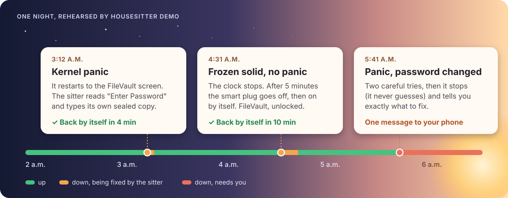

<!-- ourostack:brand:start -->
<p align="center">
  <a href="https://github.com/ourostack"></a>
</p>
<!-- ourostack:brand:end -->

# housesitter

**Your agent Mac went down at 3 a.m. and sat at the FileVault screen until you got home.** With housesitter, a $100 KVM beside it types the password at the FileVault screen, power-cycles a hang, and messages you only when it needs you.

**Experimental:** every rule is tested against a pretend Mac and KVM, and the KVM's quirks against a real one. The first restart proof on a real Mac is next ([what's verified](#whats-verified)). Watch the repo to see it.

[Quickstart](#three-cables-two-commands) · [Why not just…](#why-not-just) · [What it handles](#what-it-handles) · [Eyes and hands for agents](#eyes-and-hands-for-agents) · [Safety](#the-password-rules) · [What's verified](#whats-verified) · [More from Ouro](https://github.com/ourostack)

```sh
npx github:ourostack/housesitter demo     # one bad night, rehearsed in seconds, no hardware
```

housesitter turns a small IP-KVM next to your Mac into a sitter that never sleeps. The KVM sees the Mac's screen through HDMI and is its keyboard through USB, so it works where nothing on the Mac can: at the FileVault screen after a panic, and, with a smart plug, on a Mac frozen too hard to panic. A short script on the KVM looks every minute, types the password only at the password prompt, switches the plug off and on when the Mac hangs, and messages you once if it's stuck. Your agents get the same eyes and hands, from before login, over Tailscale, your LAN or the GitHub outbox.

<p align="center"></p>

*That night is the rehearsal `housesitter demo` prints: a pretend Mac and KVM, with the real rules and the real client. A recording of the real thing goes here after the first restart proof on real hardware ([what's verified](#whats-verified)).*

## Why not just…

- **…a smart plug?** It restarts the Mac straight into the FileVault screen, where it waits for you.
- **…a PiKVM?** You can type the password from your phone, once you notice, if you're awake.
- **…macOS 26's SSH unlock?** Use it if you can. It needs Remote Login on and the network up before boot, and it can't help a Mac that froze.

housesitter is the KVM and the plug, with nobody needing to notice.

## Three cables, two commands

<p align="center"></p>

1. **HDMI** from the Mac into the KVM. Use the Mac's own port (or a USB-C-to-HDMI adapter), not a dock.
2. **USB-C** from the KVM into a port **on the Mac itself**. The FileVault screen only sees the Mac's own ports.
3. **Ethernet** for the KVM, with PoE or its own USB-C power. Never power the KVM through the smart plug.

Then, on the agent Mac itself (or any Mac on the same network), with Node 20 or later:

```sh
npm install -g github:ourostack/housesitter
housesitter secret studio mac-password                        # once, into your Keychain; typed, never shown
housesitter adopt studio --address 192.168.1.50 --this-mac --notify ntfy
```

`--notify ntfy` makes a private [ntfy](https://ntfy.sh) topic for your phone, and the sitter says hello on it before `adopt` finishes; `--notify <url>` posts to any webhook instead. Add `--heartbeat <url>` (a [healthchecks.io](https://healthchecks.io) ping URL or similar) to hear when the KVM itself goes quiet. The address is the KVM's, from your router.

`adopt` sets the KVM's admin password, turns its API on, pins its certificate, checks the picture and the keyboard, installs the sitter, seals the Mac's password on the KVM, and joins your tailnet if you give it a tagged auth key. On a new GL.iNet unit you paste one password into its first-run page; `adopt` puts it on your clipboard and opens the page. It stops at anything else that needs you and says what. Rehearse it first with `housesitter adopt studio --fake --notify ntfy`.

On the Mac, once: `sudo pmset -a autorestart 1 displaysleep 0`, so it turns back on when the plug does and keeps the KVM's picture alive, and start your agents at login (a login item or a LaunchAgent), so they come back with it. To undo everything on the KVM: `housesitter forget studio --yes`.

## What it handles

| When your Mac… | The sitter on the KVM | Back in |
| --- | --- | --- |
| **kernel-panics** and restarts to the FileVault screen | sees the Mac boot, waits for the password prompt to settle, types its sealed copy of the password | about 4 min |
| **freezes solid** (frozen clock, no answer, still drawing power) | after 5 minutes, smart plug off for 10 s, then on by itself, then unlocks | about 10 min |
| **loses power** | nothing to do until power is back; the Mac boots (`autorestart`), then it unlocks | power + 4 min |
| **keeps falling back** to FileVault | three unlocks an hour at most, then it tells you | you decide |
| **won't take the password** | two tries, then it stops and tells you exactly what to fix | you decide |
| **is fine, but your agents can't reach it** | nothing; the desktop clock is ticking, so it never power-cycles a working Mac | — |
| **is fine, but the KVM dies** (power, network, firmware) | can't tell you itself, so it pings a dead man's switch you choose ([healthchecks.io](https://healthchecks.io) or similar; `"heartbeat"` in the config) every minute, and that service messages you when the pings stop | minutes |

It calls a Mac frozen when it has stopped answering on the network for 5 minutes while it still has power. A ticking menu-bar clock overrules that, so it never power-cycles a Mac that has only lost its network: keep the clock in the menu bar (the default), and don't leave a full-screen app in front.

Every action has a budget: three unlocks an hour, one power cycle per 30 minutes and three a day. The same failure twice means stop and tell you, once, with a reminder every six hours at most and a "back" message when it recovers. Messages go to [ntfy](https://ntfy.sh) or any webhook. Hangs need the smart plug; without one, it unlocks FileVault and tells you about a hang.

## Eyes and hands for agents

The KVM is the pixel layer: below the accessibility tree, before login, on a frozen app. housesitter speaks the computer-use actions agents already know.

```js
import { open } from '@ouro.bot/housesitter';

const mac = await open('studio');                    // over the tailnet, LAN or GitHub outbox; mac.via says which
const shot = await mac.screenshot({ maxWidth: 1280 }); // JPEG; later coordinates are in its pixels
await mac.computer({ action: 'left_click', coordinate: [640, 400] });  // Anthropic computer-use input, as-is
await mac.key('cmd+space');
await mac.type('Activity Monitor');
```

The same from a shell, for any agent: `housesitter screenshot studio`, `click`, `type`, `key`, `scroll`, and `housesitter computer studio '{"action":"left_click","coordinate":[640,400]}'`. Coordinates map from the screenshot you saw to the Mac's real resolution, so an agent never does that arithmetic.

`housesitter ls studio` gives the Mac as one screen in Ouro Reins, our small protocol for letting agents drive any app: its state and only the actions available right now, each with a JSON Schema. `housesitter do studio <action> '<json>'` runs one; refusals are `action-unavailable` (with what is available), `input-invalid` (with the JSON path) and `action-failed`. An accessibility-tree driver composes with it and falls back to it when there is no tree.

## Reach it from anywhere

| Route | How | Good for |
| --- | --- | --- |
| **Tailscale** | the KVM joins your tailnet as `tag:kvm`, reaching nothing; [`housesitter tailnet-policy`](docs/tailnet-policy.hujson) prints the policy | your devices, anywhere |
| **LAN** | its address at home, pinned certificate | setup, and home |
| **GitHub outbox** (optional, `adopt --outbox`) | the sitter posts its status to a secret gist and polls another for requests, about 2-4 s a round trip | an agent host that can't join your tailnet; works while the Mac is down |

The GitHub outbox turns a GitHub account into a keyboard for the Mac, so it's off unless you ask for it. Its token on the KVM can touch gists and nothing else; requests run once and expire after 10 minutes; the password never goes through it. Screenshots you ask for do pass through it, and a secret gist is private only by its unguessable address, so use the tailnet if your screen is sensitive. Polling costs nothing against GitHub's rate limit while the inbox is unchanged (conditional requests that return 304 are free).

Transports are pluggable (`registerTransport`), so another KVM or relay can slot in.

## The password rules

The point of housesitter is to type a password with nobody watching, so it is careful about exactly that:

- **It types only at the prompt.** With OCR, it reads "Enter Password" fresh before every unlock. Without it (the Comet at 2K has none that works), it types only right after a real boot, which it sees as the Mac enumerating the KVM's keyboard again, on a settled screen with no menu bar. A desktop is a hard no, because the password would land in whatever has focus. HDMI waking up alone never counts as a boot.
- **It lives in two places: your Keychain and the KVM.** It travels once, over SSH stdin, to the KVM, where it is encrypted with a key derived from the KVM's hardware ids and kept root-only. That stops a copied file, not root on the KVM. It is never in argv, a log, a status file, a gist or a cloud.
- **Nothing types it remotely.** No command sends the password; `housesitter unlock` asks the sitter to type its own copy, under the same rules.
- **Budgets.** Three unlocks an hour at most; two wrong passwords in a row and it stops.
- **The KVM reaches nothing.** On your tailnet it is `tag:kvm` with no outbound rules; GL.iNet's cloud binding is turned off.

[docs/security.md](docs/security.md) has the threat model, and why the encryption is built from Python's standard library (a KVM may have no AES module, and nothing should be installed on it).

## Hardware

**What to buy** (prices approximate, November 2026):

| Item | Why | About |
| --- | --- | --- |
| [GL.iNet Comet PoE (GL-RM1PE)](https://www.gl-inet.com/products/gl-rm1pe/) | the KVM housesitter is built against | $100 |
| [Shelly Plug US Gen4](https://us.shelly.com/products/shelly-plug-us-gen4-black) (optional) | restarts a Mac that froze | $25 |
| a PoE injector, only if your switch has no PoE | powers the KVM over its Ethernet cable; or use its USB-C power port | $20 |
| a short HDMI cable and a USB-C cable | | — |

About $125-145 all in. The non-PoE Comet (GL-RM1) runs the same firmware and should work; it hasn't been tried.

- **KVM:** the Comet runs GLKVM, GL.iNet's fork of PiKVM's kvmd. Any KVM with PiKVM's API should work; only the Comet has been tried. Its quirks are handled: the REST API ships off, the encoder runs only while something watches, an old dropbear wants ECDSA keys.
- **Smart plug (optional, for hangs):** a [Shelly Gen2+ or Gen4](https://us.shelly.com/) plug, over Wi-Fi or, where the plug can't join the network, Bluetooth from the KVM. Any plug you can drive from a shell works through the `command` adapter.
- **Not for Macs:** ATX power boards. A Mac has no ATX header. A Fingerbot on the power button is supported if you have one.

**Never change the KVM's EDID or the Mac's display mode while the Mac runs.** We did once, and our Mac mini froze until a power cycle. housesitter takes whatever the Mac sends. [docs/hardware.md](docs/hardware.md) has the wiring, that story, and what to buy.

## What's verified

housesitter is experimental (0.1). Honest status, as of 2026-11-08:

| Part | Status |
| --- | --- |
| Watchdog rules, sitter, adopt, transports, Reins, demo | **Tested with fakes**: 76 tests in Node and Python, on every push |
| GL-RM1PE quirks (API off, idle encoder, H.264 snapshots, no OCR at 2K, ECDSA) | **Seen on real units**, by [kvm-pilot](https://github.com/DustinTrap/kvm-pilot) and on our own Comet (firmware V1.7.1, kvmd 4.82), and handled in code; housesitter itself has not run on it yet |
| Knowing the FileVault screen without OCR (the boot watch) | **Built on real frames** from our Comet and Mac mini, and first armed there by our private fleet tooling; not yet seen unlocking a real FileVault screen |
| A frozen Mac | **Seen for real** on 2026-11-08: after an EDID change, our Mac mini froze. The KVM saw it, and keys, the force-restart chord and the password changed nothing. With no smart plug yet, it needed a person, which is exactly what the plug is for |
| FileVault unlock on a real Mac | **Not yet verified.** The first restart proof on a Mac mini (M5 Pro) is next, recorded with `housesitter proof` |
| Which display shows the FileVault screen when the Mac has other displays attached | **Unknown.** If it isn't the KVM's, the sitter sees a blank screen and tells you rather than typing blind. A headless Mac with only the KVM attached is the simple case |
| Reading the screen with OCR | **English macOS only** for now: the sitter looks for "Enter Password". The boot watch reads no words, so it works in any language |
| Shelly over Bluetooth from the KVM | **Not yet verified**: depends on the KVM's Bluetooth stack |

## Friends and prior art

- **[kvm-pilot](https://github.com/DustinTrap/kvm-pilot)** is the MCP server to reach for when an agent needs BIOS, bootloader, BMC or OS-install control over a KVM. housesitter is narrower: an always-on sitter for one Mac, living on the KVM itself. Its live GL-RM1PE findings are built in here, and our hardware reports go back to it.
- **[PiKVM](https://pikvm.org)** made the open KVM and the API everything here speaks. **[JetKVM](https://jetkvm.com)** and **NanoKVM** are worth watching.
- **macOS 26's SSH unlock** ([`apple_ssh_and_filevault(7)`](https://github.com/apple-oss-distributions/OpenSSH/blob/main/apple_ssh_and_filevault.7)) unlocks FileVault over SSH when Remote Login is on and the network is up before boot. Use it if you can; housesitter covers the Macs where you can't and the hangs where nothing answers.
- [docs/prior-art.md](docs/prior-art.md) has the rest, and what we borrowed.

## For agents

[llms.txt](llms.txt) maps the docs. [AGENTS.md](AGENTS.md) has the rules for working in this repo.

## License

MIT. Made by [Ouro](https://github.com/ourostack): open-source tools for people and the agents who work beside them.
