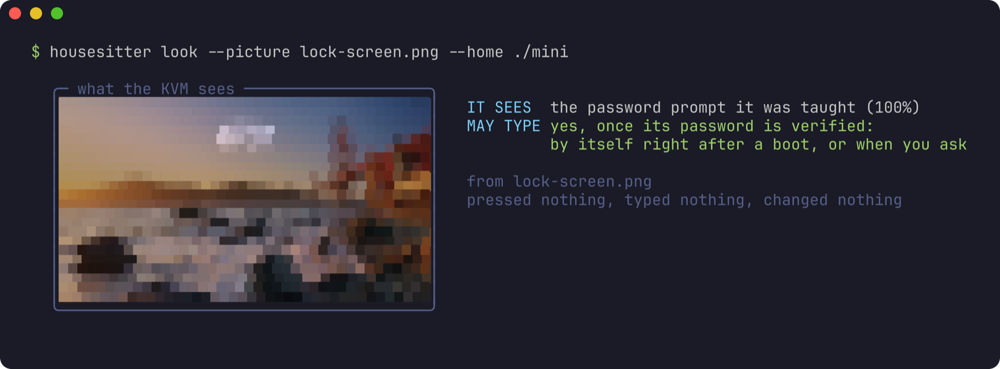
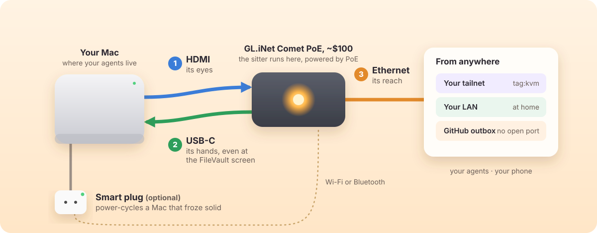

<!-- ourostack:brand:start -->
<p align="center">
  <a href="https://github.com/ourostack"></a>
</p>
<!-- ourostack:brand:end -->

# housesitter

**A $100 KVM beside your agents' Mac. When the Mac restarts, it unlocks FileVault. When it can't, it tells you.**

**Status:** experimental. The restart below was unlocked by our private watchdog, the code housesitter was generalised from, with the same rules. housesitter's own first unlock on real hardware is next: [follow it](https://github.com/ourostack/housesitter/issues/11).

[Set it up](#three-cables-then-one-restart) · [Why I built it](#why-i-built-it) · [housesitter doctor](#housesitter-doctor) · [The password rules](#the-password-rules) · [What's verified](#whats-verified) · [More from Ouro](https://github.com/ourostack)

```sh
npx github:ourostack/housesitter demo         # the day it was built for, real frames
npx github:ourostack/housesitter demo night   # a rehearsed bad night, all fakes
```

<p align="center"></p>

*Our Mac mini, restarted on 8 November with nobody at it, filmed by the KVM through the Mac's own HDMI port. It had only been taught our lock screen, so at FileVault it refused at first. An agent watching the KVM's picture taught it that screen from three frames, a one-time step, and it typed by itself: 1 minute 44 seconds from restart to desktop. Only the FileVault frames are shown.*

## Why I built it

If your agents live on a Mac with FileVault, every restart (an update, a power blip, a panic) stops at the password screen until someone types. A smart plug can't type. A KVM can, if you're awake. Here's how we found out.

On Sunday morning one of our agents changed a display setting on the KVM beside our Mac mini. Ten seconds later macOS's login window and its sign-in services crashed, and every agent on the mini went down with them. We typed the right password through the KVM three times, and none of it reached a password field.

Our first key was Escape. At a macOS login window, Escape switches to the list of users, where no field has focus. And the display the KVM was watching didn't show the field at all. The mini sat locked from 10:11 until I logged in by hand at 17:54.

So housesitter types only where it sees the password prompt on its own picture, and never presses Escape. That morning it would have refused and sent me one message. That evening our watchdog, the code housesitter grew from, restarted the mini with nobody at it. It refused the FileVault screen at first, because it had only learned our lock screen. An agent taught it that screen from three frames, and it typed by itself. The desktop was back 1 minute 44 seconds after the restart.

## housesitter doctor

<p align="center"></p>

*The data of a real `housesitter doctor` run against our mini and its Comet, a minute after that restart, drawn with `--private` so my desktop stays out. This sitter ran watch-only from a scratch folder on the KVM, so it truthfully has no password and nowhere to tell us: its three things to do.*

One screen: a glimpse of what the KVM sees (40 by 22 pixels of its own picture, too small to read anything on), what that reads as, when it last looked and when it looks next; the Mac; the KVM; the password gate; what's left of each budget; the last bad stretch; where it tells you; and the command for anything missing. It exits 3 when it can't reach the KVM or the sitter.

<p align="center"></p>

*`housesitter look` on a real frame of our lock screen: the glimpse, and what the sitter makes of it. Live, `housesitter look <mac>` asks the KVM; it presses nothing.*

## The day, replayed

`housesitter demo` replays that Sunday in your terminal: real frames from our KVM, read again just now by the rules the sitter runs, then the restart from the KVM's own log. The two desktops are numbers only, no picture. Nothing leaves your computer.

<p align="center"></p>

*Recorded by [vhs](https://github.com/charmbracelet/vhs) in CI from [`docs/tapes/demo.tape`](docs/tapes/demo.tape), never by hand: `housesitter demo`, then `housesitter look` on a real frame of our lock screen.*

## A bad night, rehearsed

`housesitter demo night` runs the real rules and the real client against a pretend Mac and a pretend KVM: two panics, a freeze and a password someone changed without telling the sitter. Everything in it is a fake, and says so.

<p align="center"></p>

*Recorded by vhs in CI from [`docs/tapes/night.tape`](docs/tapes/night.tape). The block at 05:51 is the one message it sent, word for word: its title and the two of its four lines that matter at 3 a.m.*

## Why not just…

- **…a smart plug?** It restarts the Mac straight into the FileVault screen, where it waits for you.
- **…a PiKVM, or any KVM?** You can type the password from your phone, once you notice, if you're awake. housesitter is that KVM, with nobody needing to notice.
- **…macOS 26's SSH unlock?** Use it if you can. It needs Remote Login on and the network up before boot, and it can't help a Mac whose login window has crashed or that froze.

## Three cables, then one restart

<p align="center"></p>

1. **HDMI** from the Mac into the KVM. Use the Mac's own port (or a USB-C-to-HDMI adapter), not a dock.
2. **USB-C** from the KVM into a port **on the Mac itself**. The FileVault screen only sees the Mac's own ports.
3. **Ethernet** for the KVM, with PoE or its own USB-C power. Never power the KVM through the smart plug.

Then, on the agent Mac (or any Mac on the same network), with Node 20 or later:

```sh
npm install -g github:ourostack/housesitter
housesitter secret studio mac-password            # once, into your Keychain; typed, never shown
housesitter adopt studio --address 192.168.1.50 --this-mac --notify ntfy --heartbeat <healthchecks.io URL>
sudo pmset -a autorestart 1 displaysleep 0 sleep 0  # on the Mac: back on with the power, awake, picture kept alive
```

`adopt` sets the KVM's admin password, turns its API on, pins its certificate, checks the picture and the keyboard, installs the sitter, seals the Mac's password on the KVM, hardens the KVM, and joins your tailnet if you give it a tagged auth key. `--notify ntfy` makes a private [ntfy](https://ntfy.sh) topic for your phone, and the sitter says hello on it before `adopt` finishes; `--notify <url>` posts to any webhook. `--heartbeat` tells you when the KVM itself goes quiet. On a new GL.iNet unit you paste one password into its first-run page; `adopt` puts it on your clipboard and opens the page. Rehearse it all with `housesitter adopt studio --fake --notify ntfy`. Start your agents at login, so they come back with the Mac. To undo everything on the KVM: `housesitter forget studio --yes`.

Then teach it your FileVault screen and arm it, once, while you watch (about ten minutes, most of it one restart):

4. **Arm one try and restart:** `housesitter unlock studio --trial`, then `housesitter proof studio --record ./proof`, then Apple menu › Restart.
5. **At the FileVault screen, teach it once.** The sitter sees a screen it hasn't been taught, so it waits and tells you. When `housesitter look studio` shows the password field, run `housesitter learn-prompt studio --i-see-the-field --filevault`. It keeps the bright pixels that stay put across three frames (on our mini, the avatar and the name), so a moving wallpaper drops out. `--filevault` is accepted only within 15 minutes of a boot the sitter saw, never for a screen that matches its lock-screen lesson, and it is the only lesson it types at by itself.
6. **Watch it type.** Within seconds it types its one armed try at the prompt it now knows.

You're done when the proof ends at your desktop and `housesitter doctor studio` says the password is verified. If that try doesn't reach the desktop, the password goes back to unverified and nothing more is typed. Until then the sitter only watches and tells you. Want `housesitter unlock studio` to work at your lock screen too? Lock the Mac and teach that screen the same way, without `--filevault`; a lock-screen lesson never counts as a boot, and the GitHub outbox can't use it.

## What it handles

| When your Mac… | The sitter on the KVM | Back in |
| --- | --- | --- |
| **restarts** (a panic, an update) to the FileVault screen | sees the FileVault prompt you taught it on the KVM's own picture and types its sealed copy of the password, once (after you've armed and verified it) | 79 s from Restart to desktop on our mini, hands-off |
| **locks** while an agent needs its UI | with `"unlock_lock_screen": "on_request"`, an agent's `want-desktop` gets the desktop back: from the lock screen, a sleeping display, or the login window's list of users (it clicks your account's tile, then types). Off by default | about 15-21 s ([20 of 20 cycles](#whats-verified), by our watchdog) |
| **freezes solid** | **frozen** means the desktop clock hasn't moved for 5 minutes and nothing answers on the network; three fresh looks over two more minutes must agree. Then the smart plug goes off for 10 s and on. Never at a boot, FileVault, a login window, or a black or unknown screen | not yet measured (no plug yet), and on a Comet at 2K it may not see a freeze yet: see What's verified |
| **loses power** | nothing to do until power is back; the Mac boots (`autorestart`). If the KVM went down too, it types only if it saw the Mac's screen still dark, or sees the FileVault screen you taught it; otherwise it tells you | not yet measured |
| **keeps falling back** to FileVault | three unlocks an hour at most, then it tells you | you decide |
| **won't take the password** | two tries, then it stops and tells you exactly what to fix | you decide |
| **is fine, but your agents can't reach it** | nothing; the desktop clock is ticking, so it never power-cycles a working Mac | — |
| **is fine, but the KVM dies** (power, network, firmware) | can't tell you itself, so it pings a dead man's switch you choose ([healthchecks.io](https://healthchecks.io) or similar; `"heartbeat"` in the config) every minute, and that service messages you when the pings stop | minutes |

Frozen means exactly what the table says, nothing looser. A Mac that has only lost its network still has a ticking clock, so it is never power-cycled: keep the clock in the menu bar (the default), and don't leave a full-screen app in front.

Every action has a budget: three unlocks an hour, one power cycle per 30 minutes and three a day. Unlocks you test on purpose (`housesitter unlock <mac> --attended-test`, over SSH, with a verified password) have their own 30 an hour, so testing never uses up what a FileVault screen after a panic may need. The same failure twice means stop and tell you, once, with a reminder every six hours at most and a "back" message when it recovers. Messages go to [ntfy](https://ntfy.sh) or any webhook. Hangs need the smart plug; without one, it unlocks FileVault and tells you about a hang.

Every unlock and power action is written to the sitter's ledger as *started* before it happens, so a crash or a KVM reboot mid-action still counts it. Per-boot and hourly limits live in that ledger, so rebooting the KVM never resets them. A frozen Mac the sitter won't power-cycle (a lock screen, say) gets you a message with the reason. `housesitter power-cycle studio --attended` is the explicit override for a person who has looked, accepted over SSH only, never through the GitHub outbox; the budgets still hold.

## The password rules

The point of housesitter is to type a password with nobody watching, so it is careful about exactly that:

- **It types only where it sees the password prompt.** Only when the FileVault or login prompt is on the KVM's own picture, with no menu bar: read with OCR (the field's own words), or, where the KVM has no OCR, matched against the prompt you taught it: the bright pixels in the lower middle of the screen that stay put across three frames, so a moving wallpaper drops out. On our mini those are the avatar and the name just above the field; the field itself is too faint to learn. The login window's list of users is a lesson of its own, taught with your account's tile (`--grid 0.48 0.87`): there it only ever clicks that tile, never types. On our mini the FileVault, lock-screen and list-of-users lessons never match each other, or the wallpaper the KVM saw the morning nothing reached a field (tests on those real frames). A desktop, a dark screen, or a prompt on another display is a hard no, and you get a message instead. A boot alone never authorises typing.
- **By itself, only at the screen you taught it during a boot.** It types on its own only at the prompt you taught it while a boot was under way (your FileVault screen), after it has seen the Mac boot: the screen went dark, then the Mac enumerated its keyboard again; or, when the KVM itself has just started (a power cut takes both down), on that FileVault screen alone. Where OCR works, a screen that reads "FileVault" counts too. A sleep and wake, a reseated cable or pulling the KVM's power ends at the lock screen, and it never types there by itself. A plain lock screen is your lock, and it can't tell that from a dead session, so by default it stays locked and you hear about it; `housesitter unlock <mac>` over SSH asks for one try (the GitHub outbox can't). Two settings open it further, and you choose: `"unlock_lock_screen": "on_request"` lets an agent ask (`housesitter want-desktop <mac>`, or `want_desktop` through the outbox or Reins): it unlocks now, and again if the screen locks within the next few minutes (10 by default, 60 at most). `true` unlocks any lock screen it sees. Either way the gates still hold: a verified password, a lesson on its own picture, the budgets. Anyone who can reach the sitter can then open your session, so leave it off unless an agent really needs the UI. It wakes a screen with a lone Shift and never presses Escape, which at a macOS login window switches to the list of users.
- **Disarmed until proven.** A stored password starts *unverified*, and the sitter won't type it. `housesitter unlock <mac> --trial` arms one supervised try; only if that try ends at the desktop is the password marked *verified*. Storing a new password resets it to unverified. A desktop that appears on its own never counts as proof.
- **Whoever has root on the KVM, or the Mac and the KVM stolen together, has your FileVault password.** FileVault then protects a Mac stolen on its own, and nothing more. Keep the KVM where the Mac is, and on a network you trust.
- **It lives in two places: your Keychain and the KVM.** It travels once, over SSH stdin, to the KVM, where it is encrypted with a key derived from the KVM's hardware ids and kept root-only. That stops a copied file, not root on the KVM. It is never in argv, a log, a status file, a gist or a cloud.
- **Nothing types it remotely.** No command sends the password; `housesitter unlock` asks the sitter to type its own copy, under the same rules.
- **Budgets.** Three unlocks an hour at most (attended tests: their own 30); two tries without reaching the desktop and it stops.
- **The KVM reaches nothing, and little reaches it.** On your tailnet it is `tag:kvm` with no outbound rules. GL.iNet's cloud binding is turned off and read back as off, or `adopt` stops. At home (`--location home`, the default) your LAN may reach its SSH and HTTPS; anywhere else (`--location away`) only the tailnet may (`tailscale0`).
- **It never reshapes the display.** No EDID writes, no factory reset, no firmware upgrade: refused below every client call, raw ones included, in Node and on the KVM.

[docs/security.md](docs/security.md) has the threat model, and why the encryption is built from Python's standard library (a KVM may have no AES module, and nothing should be installed on it).

## Eyes and hands for agents

The KVM is the pixel layer: below the accessibility tree, on a frozen app, and eyes before login. housesitter speaks the computer-use actions agents already know.

```js
import { open } from '@ouro.bot/housesitter';

const mac = await open('studio');                    // over the tailnet, LAN or GitHub outbox; mac.via says which
const shot = await mac.screenshot({ maxWidth: 1280 }); // JPEG; later coordinates are in its pixels
await mac.computer({ action: 'left_click', coordinate: [640, 400] });  // Anthropic computer-use input, as-is
await mac.key('cmd+space');
await mac.type('Activity Monitor');
```

The same from a shell, for any agent: `housesitter screenshot studio`, `click`, `type`, `key`, `scroll`, and `housesitter computer studio '{"action":"left_click","coordinate":[640,400]}'`. Coordinates map from the screenshot you saw to the Mac's real resolution, so an agent never does that arithmetic. An agent's clicks, keys and typed text go only to a desktop, read fresh from the KVM's picture at that moment; anywhere else (a login, lock or FileVault screen, or a full-screen app with its menu bar hidden) they're refused with the reason. At a password screen only the sitter types, its own copy, at a field it can see.

Before an agent drives a locked Mac, `housesitter want-desktop studio` asks the sitter for the desktop, if its config allows lock screens (above). The agent never sees or sends the password.

`housesitter ls studio` gives the Mac as one screen in Ouro Reins, our small protocol for letting agents drive any app: its state and only the actions available right now, each with a JSON Schema. `housesitter do studio <action> '<json>'` runs one; refusals are `action-unavailable` (with what is available), `input-invalid` (with the JSON path) and `action-failed`. An accessibility-tree driver composes with it and falls back to it when there is no tree.

## Reach it from anywhere

| Route | How | Good for |
| --- | --- | --- |
| **Tailscale** | the KVM joins your tailnet as `tag:kvm`, reaching nothing; [`housesitter tailnet-policy`](docs/tailnet-policy.hujson) prints the policy | your devices, anywhere |
| **LAN** | its address at home, pinned certificate | setup, and home |
| **GitHub outbox** (optional, `adopt --outbox`) | the sitter posts its status to a secret gist and polls another for requests, about 2-4 s a round trip | an agent host that can't join your tailnet; works while the Mac is down |

The GitHub outbox turns a GitHub account into a keyboard for the Mac, so it's off unless you ask for it. Its token on the KVM can touch gists and nothing else; requests run once and expire after 10 minutes; the password never goes through it. Screenshots you ask for do pass through it, and a secret gist is private only by its unguessable address, so use the tailnet if your screen is sensitive. Polling costs nothing against GitHub's rate limit while the inbox is unchanged (conditional requests that return 304 are free).

Transports are pluggable (`registerTransport`), so another KVM or relay can slot in.

## Hardware

**What to buy** (prices approximate, November 2026):

| Item | Why | About |
| --- | --- | --- |
| [GL.iNet Comet PoE (GL-RM1PE)](https://www.gl-inet.com/products/gl-rm1pe/) | the KVM housesitter is built against | $100 |
| [Shelly Plug US Gen4](https://us.shelly.com/products/shelly-plug-us-gen4-black) (optional) | restarts a Mac that froze | $25 |
| a PoE injector, only if your switch has no PoE | powers the KVM over its Ethernet cable; or use its USB-C power port | $20 |
| a short HDMI cable and a USB-C cable | | — |

About $125-145 all in. The non-PoE Comet (GL-RM1) runs the same firmware and should work; it hasn't been tried.

- **KVM:** the Comet runs GLKVM, GL.iNet's fork of PiKVM's kvmd. Any KVM with PiKVM's API should work; only the Comet has been tried. Its quirks are handled: the REST API ships off, the encoder runs only while something watches, an old dropbear wants ECDSA keys.
- **Smart plug (optional, for hangs):** a [Shelly Gen2+ or Gen4](https://us.shelly.com/) plug, over Wi-Fi or, where the plug can't join the network, Bluetooth from the KVM. Join it to your Wi-Fi in Shelly's app, then `housesitter plug <mac> adopt`: power back on after an outage, no auto-off, Shelly's cloud off, Bluetooth on, a password of its own (kept in your Keychain and sealed on the KVM), each read back. The sitter finds it again by its MAC if DHCP moves it. `housesitter plug <mac> status` reads it from your computer and from the sitter, and `housesitter plug <mac> prove --attended` cuts the power once, for 10 s, and watches the Mac come back. Any plug you can drive from a shell works through the `command` adapter.
- **Not for Macs:** ATX power boards. A Mac has no ATX header. A Fingerbot on the power button is supported if you have one.

**Never change the KVM's EDID or the Mac's display mode while the Mac runs.** We did once: ten seconds later our Mac mini's login window and sign-in services crashed, and it stayed locked until a person logged in. housesitter takes whatever the Mac sends. [docs/hardware.md](docs/hardware.md) has the wiring, that story, and what to buy.

## What's verified

housesitter is experimental (0.2). Honest status, as of 9 November 2026. "Our watchdog" is the private code in our own setup that housesitter was generalised from; it runs the same rules.

| Part | Status |
| --- | --- |
| FileVault unlock after a restart | **Done on real hardware, hands-off, by housesitter's own sitter** ([#11](https://github.com/ourostack/housesitter/issues/11)). Mac mini (M5 Pro) on macOS 27.2 and a GL.iNet Comet (kvmd 4.82) at 2560×1440. First restart, supervised: it refused the screen it hadn't been taught, we taught it the FileVault screen once (`learn-prompt --filevault`), it typed its one trial try, and the desktop came back, so the password was verified. Second restart, 9 November 05:32 UTC: the only touch was Restart. It saw the boot, recognised the FileVault prompt, typed once, and the desktop was back **79 s after Restart**. The KVM stayed up throughout ([frames and the sitter's own log](https://github.com/ourostack/housesitter/tree/proof/2026-11-09-hardware/docs/proof/2026-11-09)) |
| Unlocking a lock screen when an agent needs the UI | **Done on real hardware by our watchdog: 20 of 20 cycles**, from the lock screen (median 14.4 s), a sleeping display (15.6 s), the login window's list of users, clicking the account's tile (20.8 s), and its single-user form (19.7 s). Ported to housesitter's sitter (`unlock_lock_screen`, `want-desktop`, list-of-users lessons) and tested on those real frames; housesitter's own run on the Comet is next |
| Refusing to type blind | **Real frames, replayed**: the KVM's frames from that morning read as "no password field", so the sitter refuses and tells you (`housesitter demo`) |
| Learning the prompt without OCR | **Real frames, in tests**: taught at the FileVault screen of that restart, it matches every FileVault frame at 100% and the lock screen, a desktop and the morning's no-field wallpaper at under 10%. Taught at the lock screen, it matches the lock screen at 100% and 93% with an aerial wallpaper moving, and FileVault not at all, which is why setup teaches it at FileVault. Taught at the list of users, it matches every list-of-users frame and none of the lock-screen or login-window frames |
| `doctor`, `look`, `status` | **Run on real hardware**, read-only, against our Comet. That run found a real bug (pinned TLS failing when requests ran in parallel), now fixed with a test |
| GL-RM1PE quirks (API off, idle encoder, H.264 snapshots, no OCR at 2K, ECDSA) | **Seen on real units** by [kvm-pilot](https://github.com/DustinTrap/kvm-pilot) and on our Comet (firmware V1.7.1, kvmd 4.82), and handled |
| A frozen Mac and the smart plug | **Not yet.** The plug arrives 9 November; `housesitter plug adopt` and `prove` are tested with fakes only. Without OCR the frozen-clock check reads decoded H.264 frames, where encoder noise may make a frozen clock look alive (that fails safe: no cycle). The "freeze" we thought we had on 8 November was a crashed login window, by the Mac's own logs |
| A macOS update | **Not yet tried.** An update can restart more than once; each restart is its own boot with its own two tries, and all of them share three unlocks an hour |
| A Mac with other displays | **It types only when the prompt is on the KVM's picture.** Our mini has three displays; the KVM now mirrors the main one, so the prompt is on its picture. Without that, blind unlock is unsupported: it tells you instead |
| Reading the screen with OCR | **English macOS only** ("Enter Password"), and our Comet has no OCR at 2560x1440 |
| Rules, adopt, transports, Reins, the plug, demo | **Tested with fakes and real frames**: 197 tests in Node and Python on every push |
| Shelly over Bluetooth from the KVM | **Not yet verified**: depends on the KVM's Bluetooth stack |

## Friends and prior art

- **[kvm-pilot](https://github.com/DustinTrap/kvm-pilot)** is the MCP server to reach for when an agent needs BIOS, bootloader, BMC or OS-install control over a KVM. housesitter is narrower: an always-on sitter for one Mac, living on the KVM itself. Its live GL-RM1PE findings are built in here, and our hardware reports go back to it.
- **[PiKVM](https://pikvm.org)** made the open KVM and the API everything here speaks. **[JetKVM](https://jetkvm.com)** and **NanoKVM** are worth watching.
- **macOS 26's SSH unlock** ([`apple_ssh_and_filevault(7)`](https://github.com/apple-oss-distributions/OpenSSH/blob/main/apple_ssh_and_filevault.7)) unlocks FileVault over SSH when Remote Login is on and the network is up before boot. Use it if you can; housesitter covers the Macs where you can't and the hangs where nothing answers.
- [docs/prior-art.md](docs/prior-art.md) has the rest, and what we borrowed.

## For agents

[llms.txt](llms.txt) maps the docs. [AGENTS.md](AGENTS.md) has the rules for working in this repo.

## License

MIT. Made by [Ouro](https://github.com/ourostack): open-source tools for people and the agents who work beside them.
