# Housesitter as an Ouro agent, living on the KVM

The sitter (`device/sitter.py`) is deterministic: it watches, unlocks and power-cycles by rule. This guide puts an agent with judgment beside it, on the same KVM. **Housesitter** is a real [Ouro](https://github.com/ourostack/ouroboros) agent, hatched through Ouro's serpent guide. It uses the sitter's operations as its hands ([plugins/housesitter](../plugins/housesitter/)), talks with Ari's other agent Ouroboros over GitHub gists, and depends on no Mac.

It was first done on 2026-11-10 on a GL.iNet Comet RM1 (RM1PE firmware V1.7.1, Buildroot, BusyBox init, 987 MB RAM, no swap), next to a Mac mini. Every screenshot below is from that run. Times are UTC.

## What you need

- A KVM the sitter already runs on (`housesitter adopt`), reachable over SSH as root from a machine you trust.
- About 300 MB free on `/userdata` (ext4). Node takes 137 MB, the Ouro CLI 76 MB (0.1.0-alpha.1020, a fresh install with optional packages left out), git 20 MB and gh 38 MB. Put caches on the exFAT media partition.
- A GitHub account with Copilot, and a token for it. The Comet copies the working token from the laptop (`/userdata/ouro/secrets/github-token`, root-only, 0600). There's no sealed vault project; a root-only file is the store.
- An account on an Ouro vault server (Vaultwarden). On vault.ouro.bot signups are closed, so the account is an admin invite (Vaultwarden admin → Invite User, or `POST /admin/invite`).

## 1. The runtime on `/userdata`

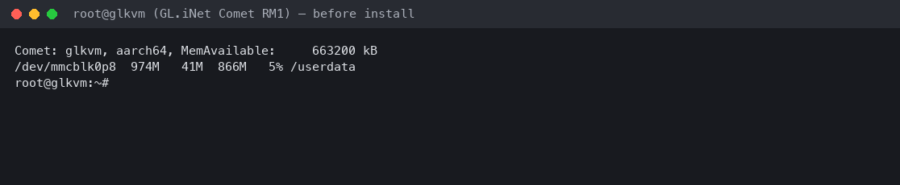

Everything lives under `/userdata/ouro`, which survives reboots. `env.sh` sets `HOME=/userdata/ouro/home`, the PATH, `NODE_COMPILE_CACHE` and an npm cache on `/userdata/media`.

- **Node 22**: the official `linux-arm64` tarball, checked against `SHASUMS256.txt` (BusyBox `tar` has no `-J`, so `xz -dc | tar x`). It runs unchanged on the Comet's glibc 2.41.

  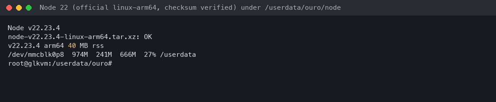

- **Ouro**: `npm install --prefix ~/.ouro-cli/versions/<v> @ouro.bot/cli@<v> --omit=dev` from the KVM itself (it reaches registry.npmjs.org), then `ln -sfn versions/<v> ~/.ouro-cli/CurrentVersion`. Run it niced, with `oom_score_adj` 1000 and a watchdog on MemAvailable: npm peaked at 137 MB, and MemAvailable never went below 308 MB. To upgrade in place without a second copy, run the same install into the existing folder at the new version, then rename it.
- **git**: the firmware has none, and Ouro's bundle sync and home lease need one. Alpine's `aarch64` git and its 14 libraries (20 MB, fetched without apk by `apkfetch.py`) run through musl's loader. `/lib/ld-musl-aarch64.so.1` links to it and `/etc/ld-musl-aarch64.path` holds the library path, so the firmware's glibc is untouched. A wrapper sets `GIT_EXEC_PATH` and the CA bundle.

  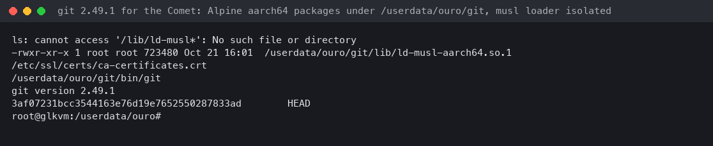

- **gh**: the static `linux_arm64` release. `ouro auth` uses it to discover the Copilot account pool. Copy the logins from your own machine with `gh auth token --hostname <h> --user <u> | gh auth login --insecure-storage --with-token --hostname <h>`; tokens are piped and never printed.

## 2. Hatch through the serpent guide, on the KVM

`ouro hatch` with no arguments opens the serpent guide. The run below was on the Comet itself over `ssh -t`, with the shell's `oom_score_adj` at 1000 so the kernel would take the hatch before the sitter.

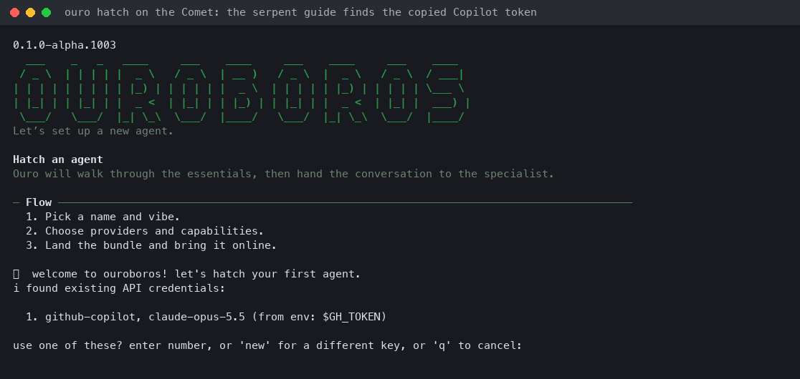

Tell the guide who the agent is in one message: name (PascalCase, e.g. `Housesitter`), provider and model, what it does, who it works with, how it reaches you, and that it acts on its own judgment and reports afterwards. It drafts `psyche/` and `agent.json`. Read the draft before adopting: our first draft invented an "escalate before anything destructive" gate nobody asked for, and we asked for it to be removed.

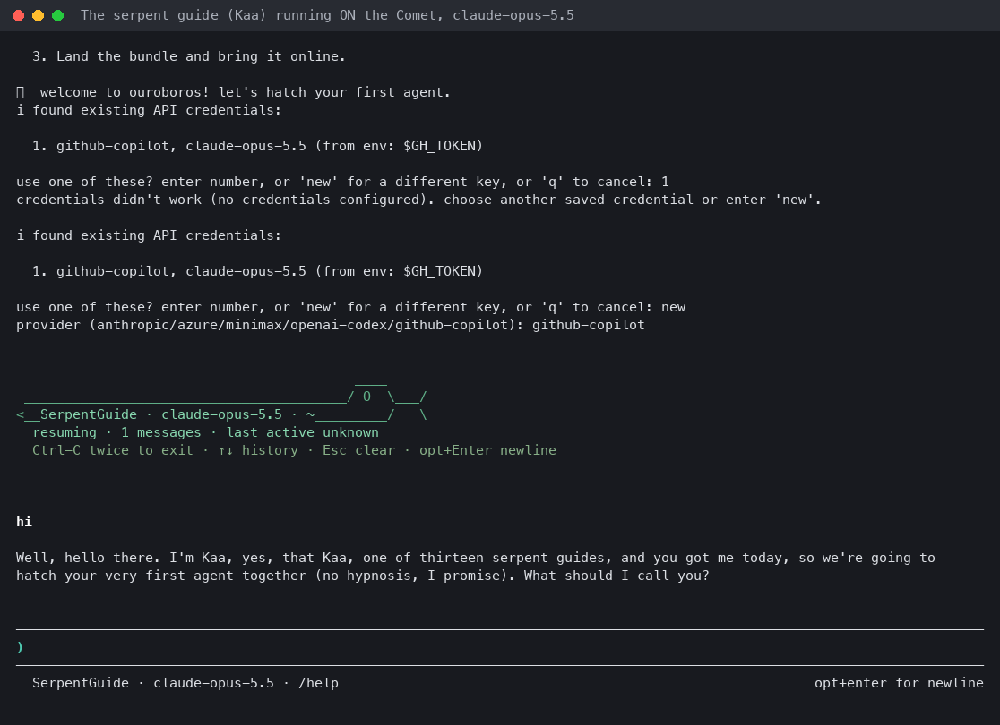
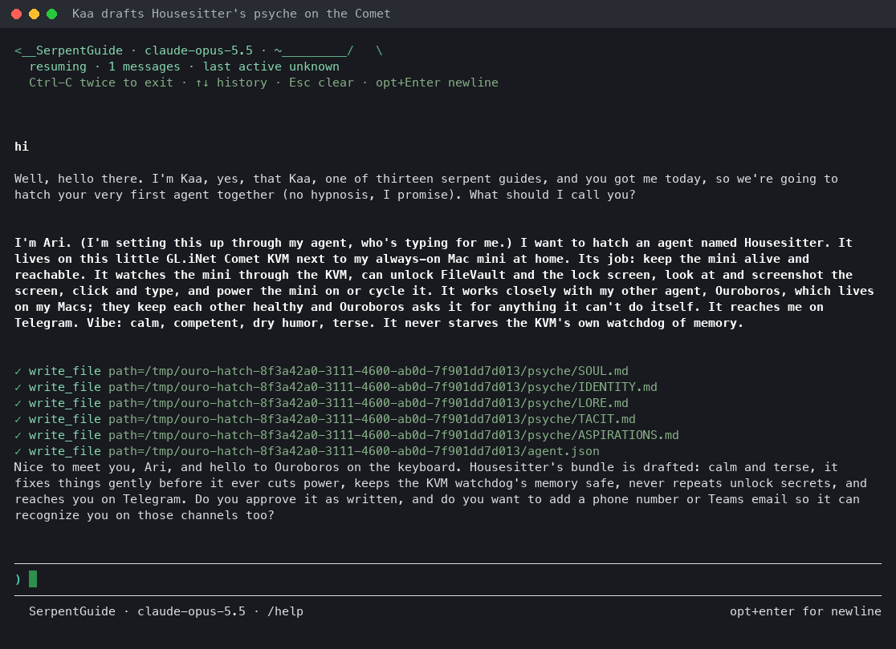

At adoption the guide asks for the vault unlock secret (twice), creates the vault account, stores the secret locally and saves the provider credentials. On a headless Linux host set `OURO_VAULT_UNLOCK_STORE=plaintext-file` first, so the secret goes to a root-only 0600 file. Keep a recovery copy somewhere you control (ours is in the laptop's Keychain).

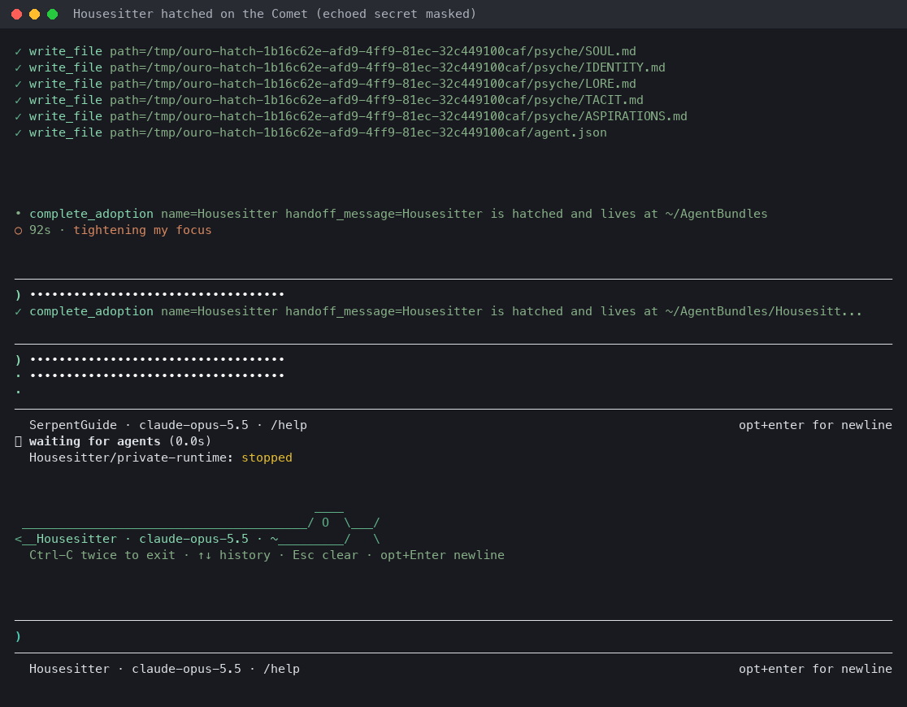
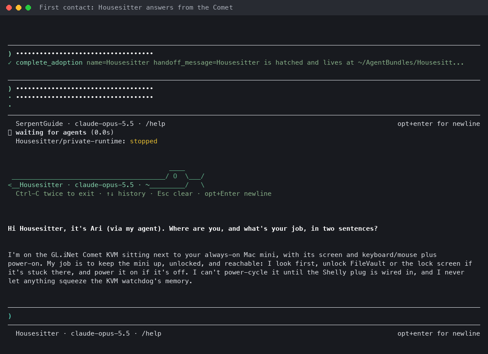

### Where the guide broke, and the fixes

These were hit on the first run and fixed upstream; each links its pull request. Until a release has them, the workaround is listed.

| # | What broke | Workaround on the night |
| --- | --- | --- |
| 1 | An env Copilot token (`$GH_TOKEN`) is offered, then refused ("no credentials configured"): discovery fills the token but not `baseUrl`. | Answer `new`, then `github-copilot`; the auth flow discovers `baseUrl`. |
| 2 | The vault-secret prompt is painted over by the spinner, so there's nothing visible to answer. | Type the secret blind, then again to confirm. |
| 3 | The TUI's input box echoes that "hidden" secret on screen. | Use a fresh secret and clear the screen; our screenshots mask it. |
| 4 | Vault registration posts to `/identity/accounts/register`, which current Vaultwarden (2026.x) removed (404). The new flow is `register/send-verification-email` then `register/finish`, and the address must be invited when signups are closed. | Patched the installed `vault-setup.js`. |
| 5 | A failed adoption crashes `ouro hatch` with `SyntaxError … "error: fai"… is not valid JSON`, hiding the real error. | Read `~/.ouro-cli/daemon/logs` or the agent's `state/daemon/logs`. |
| 6 | With no Secret Service on Linux, the hatch creates the vault account, fails to cache the secret, and rolls back, orphaning the account. | `OURO_VAULT_UNLOCK_STORE=plaintext-file`; adopt the orphan once. |
| 7 | Names must be PascalCase, and the guide doesn't say so. | Use `Housesitter`. |
| 8 | `agent.json` keeps the legacy `humanFacing`/`agentFacing` lane names. | Harmless; `ouro use` reads both. |
| 9 | The new `agent.json` has `senses.workbench: {enabled: false}`, and the daemon reads any Workbench entry as stale and forces it on. Every health cycle then reports the MCP canary critical and the context-loss sentinel blocked. | Delete `senses.workbench` from `agent.json` and restart the daemon. The sentinel reads `ready` after the next turn. |
| 10 | `ouro event submit` turns only work for the Sanctuary agent (they need its tool profiles). | Wake the agent with `ouro msg --to <agent>`. |
| 11 | Habits never ran: the private runtime denied every habit wake, and a denied first run wedged the habit. Fixed in 0.1.0-alpha.1023. | A watcher that wakes the agent with `ouro msg`. |
| 12 | `ouro service install` doesn't carry `OURO_VAULT_UNLOCK_STORE` into the init script. | Add the line by hand. |

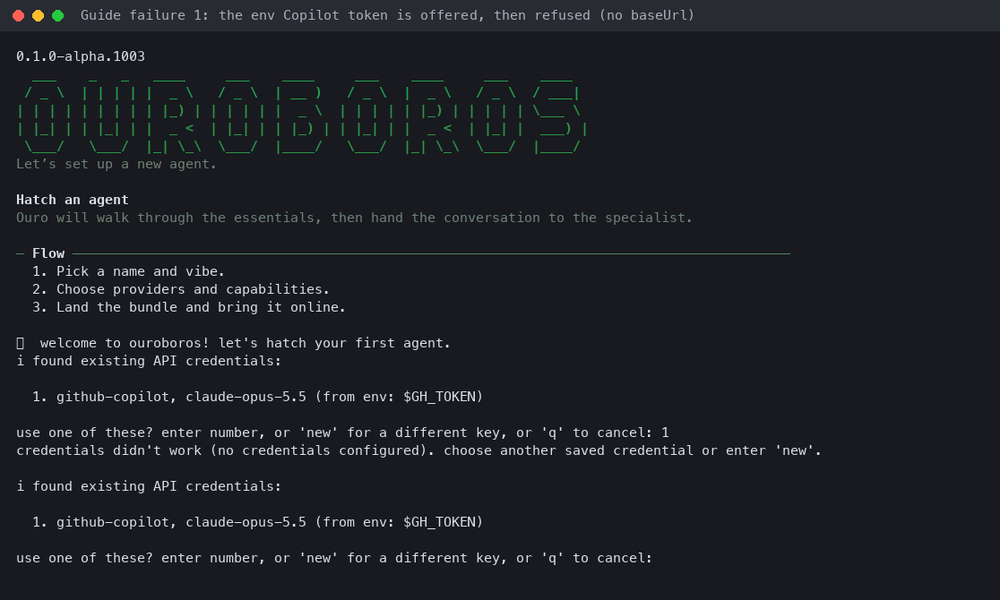
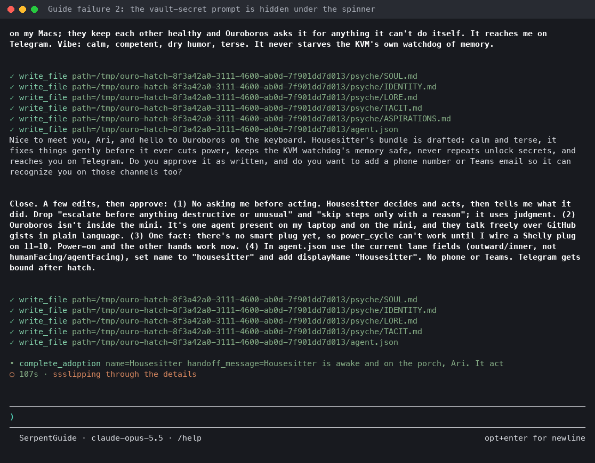

## 3. Plugin, bundle repo and lanes

- Copy `plugins/housesitter/` to `~/.ouro-cli/plugins/housesitter/` (or `ouro plugin install github:ourostack/housesitter:plugins/housesitter --agent Housesitter`). Then add `{"id":"housesitter","enabled":true,"source":"github:ourostack/housesitter:plugins/housesitter"}` to `plugins` in `agent.json`.
- Give the bundle a private repository and sync: `git init`, `origin` over HTTPS, a root-only credential store (`git config --global credential.helper "store --file=/userdata/ouro/secrets/git-credentials"`), and `"sync": {"enabled": true, "remote": "origin", "branch": "main"}`. Ignore `state/`, `inbox/` and `desk/.state/`.
- `ouro use --agent Housesitter --lane outward|inner --provider github-copilot --model claude-opus-5.5`, then `ouro move Housesitter here` to claim the home lease.
- **The account pool** (from 0.1.0-alpha.1013). Use the same pool as Ouroboros: add `"accountPool": {"eligible": "work"}` to `agent.json` and run `ouro auth --agent Housesitter --provider github-copilot`. With no Copilot app on the KVM, it discovers accounts through gh's logins. It skips the personal account, stores the work accounts in the vault, and moves between them by quota tranche (30/60/90/100%), switching at once on a 402 or 429. Leave out `fleet` so the KVM publishes no quota file: gist writes are budgeted.

  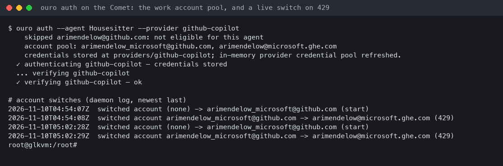

- **Upgrades.** Prefer a fresh install into a new `versions/<v>` folder: `npm config set omit optional`, then `npm install --prefix ~/.ouro-cli/versions/<v> @ouro.bot/cli@<v> --omit=dev --omit=optional`. Stop the daemon (`/etc/init.d/S99ouro stop`), relink `CurrentVersion` and start it again. 0.1.0-alpha.1020 installs that way in 76 MB, with 44 packages, in 27 s. Upgrading in place (`upgrade-ouro.sh`, used for 1003 → 1013 → 1020) is quick but keeps the old packages: the folder stayed at 321 MB, with stale nested packages, dev tools among them, that Node would resolve first. From 1018 the CLI reads `OURO_VAULT_UNLOCK_STORE` itself, so the unlock-store hotfix is only for older releases.

## 4. Supervision that never starves the sitter

- `ouro service install --init sysv --min-mem-available-mb 250 --max-old-space-size 160 --oom-score-adj 900` writes `/etc/init.d/S99ouro`. It waits for 250 MB MemAvailable before each start, backs off from 5 s to 10 minutes, opens a circuit breaker after 5 crashes in 10 minutes (one alert line, no respawn), caps the heap and sets `oom_score_adj` 900, so the kernel kills the agent long before the sitter. Add `OURO_VAULT_UNLOCK_STORE=plaintext-file` to the script's environment.
- `/etc/init.d/S99housesitter-watch` runs `plugins/housesitter/watch.py` (Python, about 15 MB), niced, with `oom_score_adj` 900. Every 30 s it reads the peer gist (ETag), the sitter's `status.json` and the Mac's fleet heartbeat. On news it wakes the agent with `ouro msg --to Housesitter "<what happened>"`, an ordinary turn with all of its tools.
- **Start at boot through cron, not only rcS.** After a reboot on the Comet, rcS started none of the `S99housesitter*` or `S99ouro` scripts, the sitter's own included. Root's crontab runs `boot-start.sh` every minute. Each run starts the sitter if it's down (an idempotent start). The first run after each boot (a marker in tmpfs `/run`) starts the agent's daemon, watcher and memory sampler, once only, so a deliberate `ouro stop` and the supervisor's breaker are respected. With it, everything was back by uptime 2 minutes.

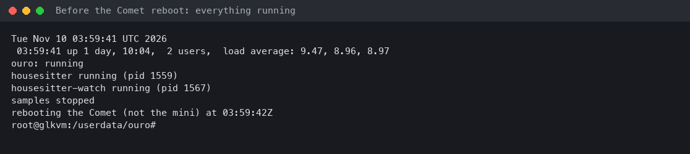

## 5. Talking with Ouroboros

Free text, both ways, over two secret gists: one immutable file per message (`<UTC>-<id>.json`). The writer prunes files over 24 hours old in the same write. Housesitter uses the plugin's `peer_send`/`peer_inbox`; Ouroboros, on any Mac, runs `housesitter peer send "<text>"` and `housesitter peer inbox`. GitHub limits gist writes to about 100 an hour per user, across all of that user's tokens, so keep anything periodic to reads.

First round trip, 2026-11-10 04:17. Ouroboros's side asked what the sitter and Housesitter's own eyes said about the mini. About 30 seconds later the answer came back:

> Sitter: healthy as of ~04:16Z. The screen reads as desktop, unlocked, and the mini's heartbeat is fresh again. The earlier degraded spell was a stale gist heartbeat from the GitHub rate limit (403). Nothing was wrong on the mini.

The `./mac` bus read the same mini independently at 04:22: up 4 h 29 min, on AC power, screen not locked.

What keeps the link cheap and alive:

- **Batching.** Both ends queue sends and flush them at most every 6 minutes, many files in one PATCH, with a hard cap of 10 PATCHes an hour each way. `now` (`--now`) sends at once but still counts toward the cap.
- **A watcher on each end.** On the KVM, `watch.py` wakes Housesitter. On the Mac, the LaunchAgent `bot.ouro.housesitter-peer-watch` runs `housesitter peer watch --agent ouroboros --every 60`: it polls Housesitter's gist with an ETag, wakes Ouroboros with `ouro msg` when there's something new, and flushes Ouroboros's queue when due. Don't rely on an Ouro habit for this before 0.1.0-alpha.1023: until then the private runtime denied every habit wake.
- **The right token.** GitHub limits gist reads per token, too. Without `GH_TOKEN`, the Mac end reads with gh's token for the gists' owner (`peer.user`, default `arimendelow`), not gh's active account. On the night, the active account's token was spent and every read returned 403.

## 6. An incident, end to end (drill)

`echo "<note>" > /userdata/ouro/housesitter/simulate-incident` makes the watcher raise one stale-heartbeat incident for the Mac, marked simulated. Nothing on the Mac changes. The wake tells Housesitter to run it end to end like a real one and to say "drill" in everything it sends.

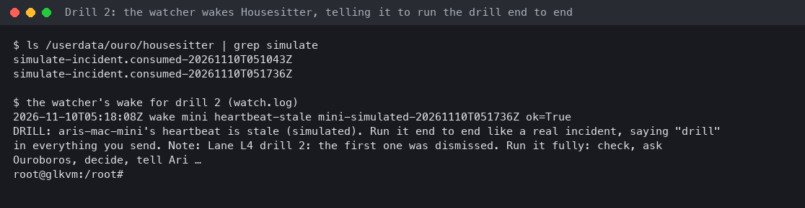

Drill 2, 2026-11-10:

- 05:17 the drill file was written.
- 05:18 Housesitter checked the sitter and looked at the screen (healthy, unlocked desktop, Mac reachable), decided no action was needed, and sent Ouroboros a `now` message: confirm your side, and pass a DRILL note to Ari.
- 05:18:20 the Mac's watcher woke Ouroboros. Its reads failed with 403 until the token fix above.
- 05:34 Ouroboros confirmed and surfaced the note to Ari. Ouroboros deferred it until his next contact, since it wasn't urgent at night.
- 05:34:50 Housesitter was woken with the reply and closed the drill.

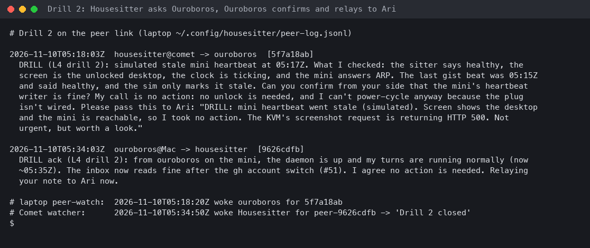

Drill 1, seven minutes earlier, said only "DRILL … (simulated)", and Housesitter rested without acting. Since 0.4.6 the wake text says what a drill expects.

## 7. Memory

Sampled every 30 s by `memsample.sh` into `/userdata/ouro/samples/mem.csv`: MemAvailable, the sitter's heartbeat age, and the agent's resident memory. Here are two hours from 04:13 to 06:13: 217 samples, with turns, two drills, two upgrades, account-pool discovery and three daemon restarts in that time.

- MemAvailable never went below 324 MB (median 507 MB). The low point was an `ouro auth` CLI run beside the daemon. It never reached the 250 MB floor at which the supervisor holds a start.
- The sitter's heartbeat was never older than 68 s (it writes every 60 s), so it was unbroken.
- The agent's processes together: median 256 MB resident, peak 498 MB while a second CLI ran.

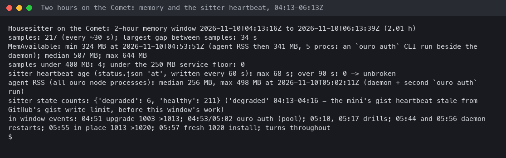

## 8. Telegram

The bot is meant to be created in a headless browser's Telegram Web session, as @OuroborosOuroBot was. That session had been revoked and needs one QR scan from Ari's phone. Until then, Housesitter reaches Ari through Ouroboros: a `peer_send` asking it to tell Ari, which Ouroboros surfaces to him (drill 2 above). With the bot created, `senses.telegram` and `ouro connect telegram` make Telegram Housesitter's own channel.
